# Editorial workflow state machine — APPROVED BASELINE (D-18, D-22, D-23)

Status: approved baseline for implementation (Phase 2 builds it; Phase 1 provides the permission registry and pure policy functions). Implements D-18/ADR-0011, **D-22/ADR-0015** (an author may publish their own listing only after another authorised person approved the exact revision), **D-23/ADR-0016** (no Publisher role in the initial implementation), D-12, D-14. Values depending on OPEN decisions are tagged `[OQ-n]`. The machine is enforced in one place — the `publishing` service — and by DB constraints (ERD §7). Django Admin, any future editorial UI and the editorial API all call the same service functions; none may write state columns directly.

## 1. Two linked state machines

A listing (`opportunity`) moves through its **lifecycle**; each content snapshot (`opportunity_version`) moves through the **review pipeline**. For a listing that has never been published, `listing.status` equals the state of its single open version. After first publication, the listing's status is one of `published | expired | withdrawn | archived`, and any further edit travels as a separate **amendment** version that does not change what the public sees until it is published.

| Listing status | Meaning | Publicly visible? |
|---|---|---|
| draft | being written by its author | no (404, `noindex`) |
| in_review | submitted, awaiting an Editor | no |
| approved | approved by another authorised person, awaiting publication | no |
| rejected | returned with reasons | no |
| published | live | yes |
| expired | deadline passed (or manually expired) | per OQ-20 |
| withdrawn | issuer withdrew the opportunity | per OQ-20 |
| archived | closed out; `archive_reason` = `housekeeping | takedown | abandoned` | `takedown`/`abandoned`: never; `housekeeping`: per OQ-20 |

| Version state | Mutable? | Meaning |
|---|---|---|
| draft | yes (author only) | working copy |
| in_review, approved, rejected | no | frozen at submit (content hash recorded) |
| published | no | the live version (at most one) |
| superseded | no | replaced by a newer published version |
| discarded | no | abandoned draft/rejected version |

## 2. Diagram

```mermaid
stateDiagram-v2
    [*] --> draft: T01 create_draft (Contributor)
    draft --> draft: T02 save_draft (author)
    draft --> in_review: T03 submit (author)
    in_review --> approved: T04 approve (Editor or Administrator ≠ author)
    in_review --> rejected: T05 reject (Editor or Administrator ≠ author)
    approved --> rejected: T06 return (Editor or Administrator ≠ author)
    approved --> published: T07 publish (Editor or Administrator; exact revision approved by another person)
    rejected --> draft: T14 reopen (author; new draft version)
    draft --> archived: T13 discard (author) [abandoned]
    rejected --> archived: T13 discard (author) [abandoned]
    published --> expired: T11 expire (system at deadline, or an Editor or Administrator)
    published --> withdrawn: T10 withdraw (Editor or Administrator)
    published --> archived: T09 takedown (Editor or Administrator) [takedown]
    expired --> archived: T12 archive (Editor or Administrator) [housekeeping]
    withdrawn --> archived: T12 archive (Editor or Administrator) [housekeeping]
    expired --> archived: T09 takedown (Editor or Administrator) [takedown]
    withdrawn --> archived: T09 takedown (Editor or Administrator) [takedown]
    published --> published: T15 amend → T03…T07 on a new version
    expired --> published: T15 amend, approved and published (new deadline)
    withdrawn --> published: T15 amend, approved and published (reinstated)
    archived --> [*]
```

Approved-but-scheduled publication (`approved --> published` at a future time by the scheduler) exists only if OQ-14 is approved; otherwise T08 is absent.

## 3. Transitions

Actor roles are defined in `ROLE_PERMISSION_MATRIX.md`. "Author" means the user in `opportunity_version.author_id` of **any** version in the current review chain or who submitted it. All guard failures return HTTP 403 `separation_of_duties` or the specific error shown; stale state returns 409 `state_conflict`; a transition not allowed from the current state returns 409 `invalid_transition`.

| ID | Transition | From → To | Actor | Guards (all must hold) | Effects | Audit action |
|---|---|---|---|---|---|---|
| T01 | create_draft | ∅ → draft | Contributor | category chosen; organisation chosen or created | listing + version 1 created; `created_by`, `author_id` = actor | `opportunity.create` |
| T02 | save_draft | draft → draft | author | actor is the version's author; draft-level validation (types, lengths) | content updated; `row_version++` | `opportunity.save` |
| T03 | submit | draft → in_review | author | **publish-grade validation passes** (VALIDATION_SPEC §6): required fields, category schema valid, ≥1 source with one primary, ≥1 location, deadline not in the past if present, duplicate check run and any strong duplicate acknowledged | version frozen; `content_hash`, `submitted_by/at` set; becomes the `pending_version` | `opportunity.submit` |
| T04 | approve | in_review → approved | Editor or Administrator | actor ≠ author (every version in the chain) ≠ submitter; review checklist complete (source reviewed, duplicates reviewed, content matches source) | `review_decision(approved)`; `approved_by/at` set | `opportunity.approve` |
| T05 | reject | in_review → rejected | Editor or Administrator | actor ≠ author; `reason_code` and `reason` (≥10 chars) | `review_decision(rejected)` | `opportunity.reject` |
| T06 | return | approved → rejected | Editor or Administrator | actor ≠ author; reason required | `review_decision(returned)`; approval void | `opportunity.return` |
| T07 | publish | approved → published | Editor or Administrator | the version is `approved` by a **different** authorised person than the author (`approved_by` is neither the author of any version in the chain nor the submitter); `content_hash` equals the hash that was approved (the **exact revision**) — any material change after approval is a new version needing a new review; the actor holds publish permission; the actor may be the approver, the author, or a third person, because the approval is what matters (D-22); source provenance present; deadline (if any) still in the future; category schema version still valid; first publication assigns the slug | version → `published`, previous live → `superseded`; `live_version_id` set; `published_by`, `published_at`, `first_published_at`/`last_published_at`; listing status `published`; search index and sitemap refreshed | `opportunity.publish` |
| T08 | schedule_publish `[OQ-14]` | approved → approved(+`publish_at`) | Editor or Administrator | same as T07; `publish_at` in the future | the scheduler executes T07 as actor `system` on behalf of the scheduling user; guards re-checked at execution | `opportunity.schedule` |
| T09 | takedown | published, expired, withdrawn → archived | Editor or Administrator | reason required (`legal`, `error`, `fraud`, `other` + text) | public visibility removed immediately; `archive_reason=takedown`; **one-person action by design** (taking content down is the safe direction) | `opportunity.takedown` |
| T10 | withdraw | published → withdrawn | Editor or Administrator | reason required (issuer withdrew) | listing flagged withdrawn; `closed_at` | `opportunity.withdraw` |
| T11 | expire | published → expired | system, or Editor / Administrator | system: live `deadline_at` < now (listings with unknown deadline are never auto-expired); manual by an Editor or Administrator with reason | `closed_at`; derived `deadline_state=expired` always correct at read time even if the job has not run | `opportunity.expire` |
| T12 | archive | expired, withdrawn → archived | Editor or Administrator | — | `archive_reason=housekeeping` | `opportunity.archive` |
| T13 | discard | draft, rejected → archived | author | never published; or discards a pending amendment (version → `discarded`, listing status unchanged) | `archive_reason=abandoned` (new listing) | `opportunity.discard` |
| T14 | reopen | rejected → draft | author | — | new draft version `n+1` copied from the rejected one; old stays `rejected` | `opportunity.reopen` |
| T15 | amend | published, expired, withdrawn (no open amendment) | Contributor (any; becomes the amendment's author) | at most one open pipeline version per listing | new draft version copied from the live one (`based_on_version_id`); listing status unchanged; then T03→T07 apply to the amendment | `opportunity.amend` |
| V01 | record_verification (not a status change) | version in_review/approved/published | Editor or Administrator | actor ≠ author of that version; evidence note ≥20 chars | `verification_record`; recompute `opportunity.verification_level` if live | `verification.record` |

## 4. Invariants (tested)

1. **Nobody approves their own work:** the author of any version in the chain, and the submitter, can never approve, reject, return or verify it. This is the whole separation-of-duties rule for approval.
2. **Publication requires another person's approval of the exact revision (D-22).** Only an Editor or Administrator can publish. They may publish a listing they approved, a listing someone else authored, or a listing they authored themselves — but never a revision that has not been approved by a different authorised person, and never a revision whose hash differs from the one approved. Self-approval is impossible, so an author-publisher always needs a second person's approval first.
3. **Approval binds content:** any content change after approval is impossible (versions are immutable); a changed listing is a new version and needs a fresh approval.
4. **Administrators hold approval and publication authority by role, bounded by the same guards:** they cannot approve what they authored, cannot publish an unapproved or changed revision, cannot skip states, cannot edit content, and every use of the authority is audited with the capacity exercised.
5. **Publishing ≠ verifying:** T07 never writes `verification_level`; publication of an unverified listing displays `not_verified`.
6. **At most one live version and one pipeline version per listing** (partial unique indexes).
7. **Every transition is audited:** a `publishing_event` and an `audit_event` (actor, capacity, transition, versions, reason, request id) are written in the same DB transaction as the state change; if the audit write fails the transition fails. Rejected attempts (guard failures) are audited as `security` events.
8. **Slug assigned once**, at first publication; never changed afterward (ADR-0006).
9. **Deadlines are never invented:** unknown deadline = `NULL`; the state machine never infers one.
10. **System actor limits:** the only system-initiated transition in Release 1 is T11 (and T08 execution if OQ-14 is approved).

## 5. Concurrency and idempotency

- Every transition request carries `expected_row_version` (and the target `version_no`). The service locks the listing row (`FOR UPDATE`), compares, applies, increments. Mismatch → 409 `state_conflict`.
- Repeating a transition that already happened returns 409 `invalid_transition` (no double effect). The expiry job is idempotent and safe to run concurrently (it re-checks the state under lock).

## 6. Error codes (editorial)

`invalid_transition`, `state_conflict`, `separation_of_duties`, `validation_failed`, `source_required`, `duplicate_detected`, `approval_stale`, `deadline_in_past`, `amendment_already_open`, `permission_denied`.

## 7. Queues and views (for the staff interface)

Contributor: own drafts and rejected items. Editor and Administrator: the `in_review` queue excluding items they authored, and the `approved` queue (they may publish approved items, including their own). Everyone with a staff role sees the history (`publishing_event`) of items they may view. These are views over the same tables, not separate states.
