# Entity relationship diagram and database relationships — DRAFT

Status: DRAFT for review. Documentation only; no migrations exist or are authorised. Implements D-12 (hybrid model), D-13 (immutable ids, stable slugs), D-14 (provenance ≠ verification), D-09 (separation of duties), D-11 (email outbox). Items depending on OPEN decisions are marked `[OQ-n]`. Types are PostgreSQL types. "Release 1" tables only; deferred tables are listed in §6.

Supersedes the entity lists in `DOMAIN_MODEL.md` where they differ (notes there point here).

## 1. Conventions

- **Primary keys:** `uuid`, generated by the application, never updated (enforced by a trigger that rejects `UPDATE … SET id`). UUID version (v4 vs time-ordered v7) is chosen at Phase 1 with the version pins [OQ-28]. Exception: `audit_event.id` is `bigint GENERATED ALWAYS AS IDENTITY` (append-only, ordered log).
- **Public identity:** listings are addressed publicly by `slug` (stable). `id` is internal but may appear in API payloads; clients must not construct URLs from it (see ADR-0006).
- **Time:** `timestamptz` stored in UTC. Deadlines also store the IANA zone.
- **Enums:** PostgreSQL enums or `text` + `CHECK` (decided at implementation; the value sets below are the contract).
- **Deletion:** no hard delete of listings, versions, sources, verification records, publishing events or audit events. User deletion follows §5. Lookup (taxonomy) rows are deactivated, not deleted.
- **Concurrency:** mutable aggregates carry `row_version int` for optimistic locking; transitions also take `SELECT … FOR UPDATE` on the listing row.

## 2. Diagram

```mermaid
erDiagram
    USER ||--o| PROFILE : has
    USER ||--o{ STAFF_ROLE_ASSIGNMENT : holds
    USER ||--o{ AUTH_TOKEN : receives
    USER ||--o{ USER_SESSION : opens
    USER ||--o{ SAVED_OPPORTUNITY : saves
    USER ||--o{ EMAIL_OUTBOX : "is sent"
    PROFILE ||--o{ PROFILE_CATEGORY_INTEREST : lists
    PROFILE ||--o{ PROFILE_SECTOR_INTEREST : lists
    PROFILE ||--o{ PROFILE_LOCATION : prefers
    PROFILE ||--o{ PROFILE_SKILL : has
    PROFILE ||--o{ PROFILE_FIELD_OF_STUDY : studied
    CATEGORY ||--o{ PROFILE_CATEGORY_INTEREST : "chosen in"
    SECTOR ||--o{ PROFILE_SECTOR_INTEREST : "chosen in"
    LOCATION ||--o{ PROFILE_LOCATION : "chosen in"
    SKILL ||--o{ PROFILE_SKILL : "chosen in"
    FIELD_OF_STUDY ||--o{ PROFILE_FIELD_OF_STUDY : "chosen in"

    CATEGORY ||--o{ OPPORTUNITY : classifies
    CATEGORY ||--o{ DETAIL_SCHEMA : "has versions"
    ORGANISATION ||--o{ OPPORTUNITY_VERSION : issues
    USER ||--o{ OPPORTUNITY : creates
    OPPORTUNITY ||--|{ OPPORTUNITY_VERSION : "has versions"
    OPPORTUNITY ||--o| OPPORTUNITY_VERSION : "live version"
    OPPORTUNITY ||--o| OPPORTUNITY_VERSION : "pending version"
    OPPORTUNITY_VERSION ||--|{ OPPORTUNITY_SOURCE : "declares provenance"
    OPPORTUNITY_VERSION ||--o{ VERIFICATION_RECORD : "is checked by"
    OPPORTUNITY_VERSION ||--o{ REVIEW_DECISION : "is reviewed by"
    OPPORTUNITY_VERSION ||--|{ VERSION_LOCATION : "applies in"
    OPPORTUNITY_VERSION ||--o{ VERSION_SKILL : requires
    OPPORTUNITY_VERSION ||--o{ VERSION_SECTOR : "belongs to"
    LOCATION ||--o{ VERSION_LOCATION : "used by"
    SKILL ||--o{ VERSION_SKILL : "used by"
    SECTOR ||--o{ VERSION_SECTOR : "used by"
    OPPORTUNITY ||--o{ SAVED_OPPORTUNITY : "saved as"
    OPPORTUNITY ||--o{ PUBLISHING_EVENT : "history"
    USER ||--o{ VERIFICATION_RECORD : performs
    USER ||--o{ REVIEW_DECISION : decides
    USER ||--o{ OPPORTUNITY_VERSION : authors
```

`audit_event`, `job_run`, Django `session` and `cache` tables are standalone and omitted from the diagram.

## 3. Tables

### 3.1 accounts

**`app_user`** — identity and account state.
| Column | Type | Constraints |
|---|---|---|
| id | uuid | PK |
| email | citext | NOT NULL, UNIQUE (case-insensitive); ≤254 chars |
| email_verified_at | timestamptz | NULL until verified |
| password_hash | text | NOT NULL (Argon2id encoded hash); never returned by any API |
| status | enum | `pending_verification, active, restricted, suspended, deactivated`; NOT NULL; semantics [OQ-15] |
| display_name | text | NOT NULL, 1–80 |
| last_login_at, created_at, updated_at | timestamptz | |
| deletion_requested_at, deleted_at | timestamptz | NULL unless in deletion flow (§5) |
| row_version | int | NOT NULL default 0 |

CHECK: `status <> 'active' OR email_verified_at IS NOT NULL` (an active account always has a verified email). Index: unique on `email`.

**`staff_role_assignment`** — additive editorial/admin roles (D-09). Seekers need no row.
| Column | Type | Constraints |
|---|---|---|
| id | uuid | PK |
| user_id | uuid | FK → app_user, PROTECT |
| role | enum | `contributor, editor, publisher, administrator` |
| granted_by, granted_at | uuid, timestamptz | NOT NULL |
| revoked_by, revoked_at | uuid, timestamptz | NULL while active |
| reason | text | NOT NULL, ≥10 chars |

Partial UNIQUE `(user_id, role) WHERE revoked_at IS NULL`. Every insert/update writes an `audit_event` (severity `privileged`). Roles are re-read on every request (never cached in the session). No role implies another.

**`auth_token`** — one-time tokens for email verification and password reset.
`id (random uuid, the public selector), user_id (FK, CASCADE), purpose (email_verification|password_reset), target_email citext, expires_at, used_at, invalidated_at, created_at`. No secret is stored: the emailed token is `id` plus an HMAC derived from a server-side key (SECURITY_ARCHITECTURE §3.5), so a database leak yields no usable token. Partial UNIQUE `(user_id, purpose) WHERE used_at IS NULL AND invalidated_at IS NULL` (issuing a new token invalidates the previous one).

**`user_session`** — metadata for "manage sessions". `id, user_id (FK CASCADE), session_key_hash bytea UNIQUE, created_at, last_seen_at, user_agent_summary text (browser/OS family only), ip_prefix inet (truncated /24 or /48) , revoked_at`. The Django `session` table holds the session payload (database-backed sessions while Redis is deferred, ADR-0004).

### 3.2 profiles

**`profile`** — `user_id uuid PK/FK (CASCADE)`, `country char(2) NOT NULL default 'ZW'` (ISO 3166-1 alpha-2), `highest_qualification enum NULL (secondary, diploma_certificate, degree, postgraduate)`, `experience_level enum NULL (none, entry, mid, senior, executive)` [value set to confirm], `work_arrangements enum[] NOT NULL default '{}' (on_site, hybrid, remote)`, `updated_at`.
Join tables (each: composite PK, FKs, CASCADE from profile, PROTECT to taxonomy): `profile_category_interest(user_id, category_id)`, `profile_sector_interest(user_id, sector_id)`, `profile_location(user_id, location_id)`, `profile_skill(user_id, skill_id)`, `profile_field_of_study(user_id, field_of_study_id)`. Per-profile caps are in VALIDATION_SPEC. Sectors vs fields of study may merge [OQ-21].

### 3.3 taxonomies (reference data; deactivated, never deleted)

| Table | Columns |
|---|---|
| `category` | id, `code` text UNIQUE immutable (`jobs, internships, graduate-programmes, scholarships, tenders, grants`), name, `detail_schema_key` text, sort_order, active |
| `location` | id, name, `kind` enum (`country, province, city, remote`), parent_id (self FK), slug UNIQUE, active; contents [OQ-21] |
| `sector` | id, name, slug UNIQUE, active; contents [OQ-21] |
| `skill` | id, name, `name_normalized` UNIQUE, `status` enum (`approved, pending`), active; ownership and user suggestions [OQ-21] |
| `field_of_study` | id, name, slug UNIQUE, active [OQ-21] |
| `detail_schema` | id, category_id FK, `version` int, `schema_sha256` bytea, `status` enum (`draft, active, retired`), activated_at; UNIQUE `(category_id, version)`; partial UNIQUE `(category_id) WHERE status='active'`. Schema documents live in the repository (`apps/api/…/schemas/<category>/v<N>.json`) and are authoritative; this table records which version is active and its hash. |

### 3.4 organisations

**`organisation`** — `id, name, name_normalized, website_url NULL, created_by (FK app_user), created_at, merged_into_id NULL (self FK), row_version`. Index: GIN trigram on `name_normalized` (duplicate suggestion). No public pages in Release 1 (D-15), so no slug column. Changing a name affects displayed live listings: edits are audited (see matrix).

### 3.5 opportunities (hybrid model, D-12)

**`opportunity`** — the listing aggregate and its lifecycle.
| Column | Type | Constraints |
|---|---|---|
| id | uuid | PK |
| slug | text | UNIQUE, NULL until first publication, then immutable (trigger); format in VALIDATION_SPEC |
| category_id | uuid | FK PROTECT, NOT NULL, immutable |
| status | enum | `draft, in_review, approved, rejected, published, expired, withdrawn, archived` |
| archive_reason | enum NULL | `housekeeping, takedown, abandoned`; required iff status=`archived` |
| live_version_id | uuid | FK → opportunity_version, NULL, DEFERRABLE INITIALLY DEFERRED |
| pending_version_id | uuid | FK → opportunity_version, NULL (the single open version in the review pipeline) |
| verification_level | enum | `not_verified, source_checked, issuer_verified`; NOT NULL default `not_verified`; level of the **live** version, maintained by the service from `verification_record` |
| verification_checked_at | timestamptz | NULL |
| created_by | uuid | FK PROTECT |
| first_published_at, last_published_at, closed_at | timestamptz | NULL until relevant |
| created_at, updated_at, row_version | | |

CHECKs: `status='published' ⇒ live_version_id IS NOT NULL AND slug IS NOT NULL`; `slug IS NOT NULL ⇒ first_published_at IS NOT NULL`; `status='archived' ⇔ archive_reason IS NOT NULL`; `status IN ('draft','in_review','approved','rejected') AND first_published_at IS NULL ⇒ live_version_id IS NULL`.
Indexes: `(status)`, `(category_id, status)`, `(slug)` unique, `(created_by)`.

**`opportunity_version`** — immutable content snapshots (relational searchable fields + versioned JSONB).
| Group | Columns |
|---|---|
| keys | id PK; opportunity_id FK PROTECT; `version_no` int; UNIQUE `(opportunity_id, version_no)`; `based_on_version_id` FK NULL |
| state | `state` enum: `draft, in_review, approved, rejected, published, superseded, discarded` |
| core content | `organisation_id` FK PROTECT; `title` text; `summary` text; `description_md` text; `requirements_md` text NULL |
| searchable | `work_mode` enum NULL (`on_site, hybrid, remote`); `employment_type` enum NULL (`permanent, contract, temporary, part_time, internship, trainee`); `experience_level` enum NULL; `location_text` text NULL; `geographic_eligibility` text NULL |
| money (never defaulted) | `salary_min, salary_max numeric(14,2) NULL`; `salary_currency char(3) NULL`; `salary_period` enum NULL (`hour, day, month, year, once`); `funding_min, funding_max numeric(16,2) NULL`; `funding_currency char(3) NULL` |
| deadline | `deadline_at timestamptz NULL` (NULL = unknown); `deadline_timezone text NULL` (IANA); `deadline_is_date_only bool NOT NULL default false` |
| application | `application_method` enum (`external_url, email, instructions`) NOT NULL; `application_url` text NULL; `application_email` citext NULL; `application_instructions` text NULL; `reference_number` text NULL; `contact_details` text NULL |
| category detail | `detail` jsonb NOT NULL default `{}`; `detail_schema_version` int NOT NULL (FK-ish to `detail_schema(category, version)` via service); validated against the versioned JSON Schema |
| search | `search_vector` tsvector GENERATED/maintained from title (weight A), organisation name & summary (B), description/requirements/location_text (C) |
| workflow | `author_id` FK PROTECT; `submitted_by`, `submitted_at`; `approved_by`, `approved_at`; `content_hash` bytea (SHA-256 of canonical content, set at submit); `published_at`; `created_at` |

CHECKs: `salary_min <= salary_max`; `(salary_min IS NOT NULL OR salary_max IS NOT NULL) ⇒ salary_currency IS NOT NULL AND salary_period IS NOT NULL`; same pairing for funding; `deadline_at IS NOT NULL ⇒ deadline_timezone IS NOT NULL`; `deadline_is_date_only ⇒ deadline_at IS NOT NULL`; `application_method='external_url' ⇒ application_url IS NOT NULL` (and analogous for email/instructions).
Constraints: partial UNIQUE `(opportunity_id) WHERE state IN ('draft','in_review','approved')` (one open pipeline version); partial UNIQUE `(opportunity_id) WHERE state='published'` (one live version); category of the version = category of the opportunity (enforced by a trigger comparing to `opportunity.category_id` for the JSON schema).
**Immutability:** a trigger rejects `UPDATE` of content columns when `state <> 'draft'` and rejects `DELETE` always. State changes go only through the publishing service.
Indexes (all partial on the live version unless noted): GIN `search_vector WHERE state='published'`; btree `(deadline_at) WHERE state='published'`; `(organisation_id) WHERE state='published'`; `(employment_type, work_mode) WHERE state='published'`; GIN on `detail jsonb_path_ops` only if measured necessary; `(opportunity_id, version_no DESC)`. Final index set is decided after query inspection (QUALITY-GATES).

**`version_location(version_id, location_id, is_primary)`** — ≥1 row required at submit; exactly one `is_primary`. **`version_skill(version_id, skill_id, is_required bool)`**, **`version_sector(version_id, sector_id)`**. All rows immutable with the version once it leaves `draft`.

**`opportunity_source`** — provenance (where the information came from). Independent of verification (D-14).
`id, opportunity_id, version_id (FK PROTECT), kind enum (issuer_website, issuer_notice, government_gazette, newspaper, email_from_issuer, social_media, aggregator, other), name text, url text NULL, citation text NULL, observed_on date NOT NULL (date checked), is_primary bool, created_by, created_at`. CHECK `url IS NOT NULL OR citation IS NOT NULL` [OQ-29]. Partial UNIQUE `(version_id) WHERE is_primary`. Publishing requires ≥1 source with exactly one primary. Index on normalised `url` for duplicate detection.

**`verification_record`** — verification activity, never inferred from publication.
`id, opportunity_id, version_id (FK PROTECT), level enum (source_checked, issuer_verified), method enum (source_page_review, document_review, issuer_contact), outcome enum (confirmed, unable_to_confirm, discrepancy_found), evidence_note text NOT NULL (≥20 chars; no file storage in Release 1, D-15), checked_by FK PROTECT, checked_at timestamptz, supersedes_id NULL (self FK)`. Rules: `checked_by <> version.author_id` (service + trigger); append-only (corrections add a record that supersedes). A version's effective level = highest `level` among non-superseded records with outcome `confirmed`; otherwise `not_verified`. Criteria for each level [OQ-07].

**`review_decision`** — `id, version_id (FK PROTECT), decision enum (approved, rejected, returned), reason_code enum NULL, reason text NULL (required for rejected/returned), checklist jsonb NOT NULL, decided_by FK PROTECT, decided_at`. Append-only. `decided_by <> version.author_id`.

**`publishing_event`** — typed, queryable history of every workflow transition (feeds the editorial history UI). `id uuid PK, opportunity_id FK, version_id FK NULL, transition text (T01…T15, see EDITORIAL_WORKFLOW), from_status, to_status, actor_type (user|system), actor_id NULL, reason text NULL, request_id text, occurred_at`. Append-only. Written in the same transaction as the transition and as its matching `audit_event`.

### 3.6 bookmarks

**`saved_opportunity`** — `id, user_id (FK CASCADE), opportunity_id (FK PROTECT), created_at`; UNIQUE `(user_id, opportunity_id)`; index `(user_id, created_at DESC)`. Saving is allowed only for listings that have been public [OQ-31]; saved rows persist when a listing becomes expired/withdrawn/archived (the API reports its current state; takedown listings are reported as unavailable without content).

### 3.7 notifications (Release 1: outbox only)

**`email_outbox`** — durable, transactional queue for outbound email (ADR-0004).
`id uuid PK, kind enum (email_verification, password_reset, password_changed_notice, account_deletion_notice), user_id FK NULL (SET NULL on deletion), to_address citext NOT NULL, template_key text, payload jsonb (template variables and the `auth_token` id; links are derived at send time, so no secret is stored; payload scrubbed after sending), idempotency_key text UNIQUE, status enum (pending, sending, sent, failed, dead), attempts smallint default 0, next_attempt_at timestamptz, locked_at timestamptz NULL, locked_by text NULL, provider_message_id text NULL, last_error text NULL (sanitised), created_at, sent_at`. Index `(status, next_attempt_at) WHERE status IN ('pending','failed')`. Workers claim rows with `FOR UPDATE SKIP LOCKED`.

### 3.8 audit and operations

**`audit_event`** — append-only. `id bigint identity PK, occurred_at timestamptz, actor_type (user|system|anonymous), actor_ref uuid NULL (no FK — survives user deletion; pseudonymised per OQ-09), action text, object_type text, object_id uuid NULL, severity (info|privileged|security), request_id text, ip_hash bytea NULL, changes jsonb NULL (field names with old/new for non-sensitive fields only; never passwords, tokens or full emails), created_at`. The application DB role has INSERT and SELECT only on this table; `UPDATE/DELETE/TRUNCATE` are revoked. Indexes: `(object_type, object_id, occurred_at)`, `(actor_ref, occurred_at)`, `(action, occurred_at)`.
Action catalogue: `auth.register, auth.verify_email, auth.login.success, auth.login.failure, auth.logout, auth.password_reset.request, auth.password_reset.confirm, auth.password_change, account.status_change, account.deletion_request, account.deleted, role.grant, role.revoke, opportunity.<transition>, verification.record, organisation.create, organisation.update, organisation.merge, taxonomy.change, session.revoke, export.data`.

**`job_run`** — `id, job_name (expire_opportunities, process_email_outbox, purge_tokens, …), started_at, finished_at, status, counts jsonb, error_summary`. Used for monitoring and for backup/expiry health checks.

**Framework tables:** Django `session` (database-backed) and `cache` (database cache backend used for rate-limit counters while Redis is deferred).

## 4. Relationship rules summary

| Relationship | Cardinality | On delete |
|---|---|---|
| app_user → profile | 1:0..1 | CASCADE |
| app_user → saved_opportunity | 1:N | CASCADE |
| app_user → staff_role_assignment / opportunity / version / verification / decision (as actor) | 1:N | PROTECT (staff are deactivated, not deleted) |
| opportunity → opportunity_version | 1:N (≥1) | PROTECT |
| opportunity → live_version / pending_version | 1:0..1 each | n/a (deferrable FK) |
| opportunity_version → source / verification / decision / location / skill / sector | 1:N | PROTECT |
| organisation → opportunity_version | 1:N | PROTECT |
| category → opportunity | 1:N | PROTECT |
| opportunity → saved_opportunity | 1:N | PROTECT |

## 5. Deletion and retention (rules pending OQ-09)

- **Seeker deletion:** on execution, delete `profile` (+ joins), `saved_opportunity`, `user_session`, `auth_token`; revoke all sessions; replace `app_user.email`/`display_name` with irreversible tombstone values and set `status='deactivated'`, `deleted_at`. `email_outbox.to_address` for the user is scrubbed. `audit_event.actor_ref` stays as an opaque uuid. Cooling-off period, retention of audit rows and legal basis: **OPEN [OQ-09]**.
- **Staff accounts:** deactivated, never hard-deleted (authorship and approvals must stay attributable).
- **Listings:** never deleted; archived. A takedown for legal reasons keeps the audit record and removes public visibility.

## 6. Deferred (not created in Release 1)

`notification_preference`, alert subscriptions, public organisation attributes (slug, logo, description), object-storage file metadata, application tracking, employer accounts, payments/featured placements, stored match explanations (explanations are computed at read time and returned with a model version; nothing is stored). `user_preference` is folded into `profile` until a separate need is shown.

## 7. Consistency enforcement summary

1. State machine transitions only via the publishing service (no direct status writes; Django Admin status fields read-only).
2. DB triggers/constraints for: id immutability, slug immutability, version content immutability, partial uniqueness of pipeline/live versions, audit append-only privileges.
3. Separation of duties checked in the service **and** re-asserted by DB triggers for `review_decision.decided_by` and `verification_record.checked_by` vs `version.author_id`.
4. Migrations: forward-only with rehearsal on a copy; destructive operations require explicit review.
